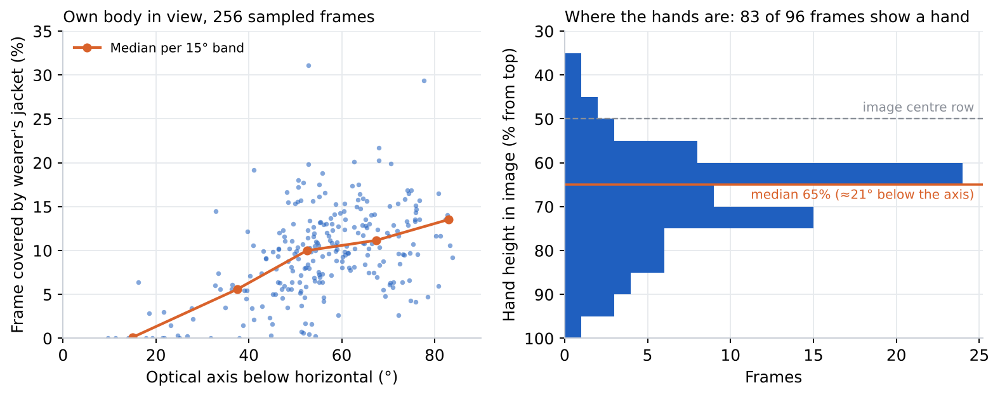
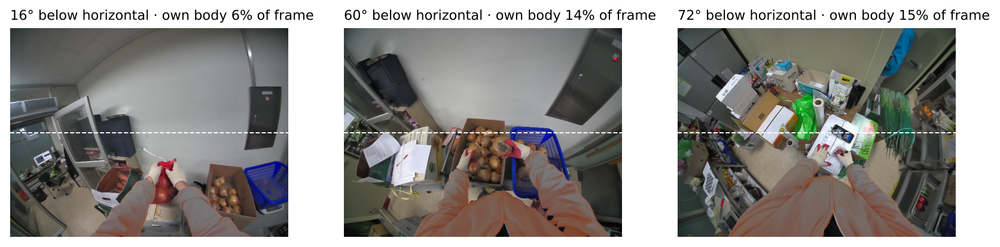
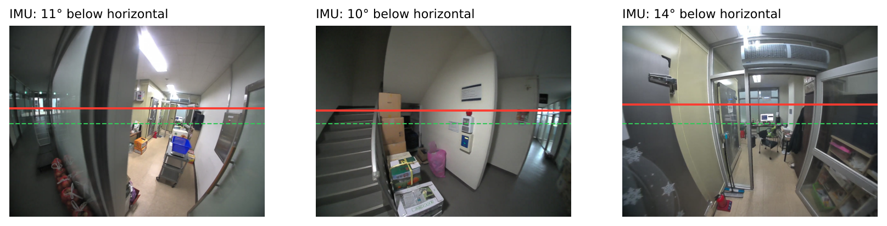
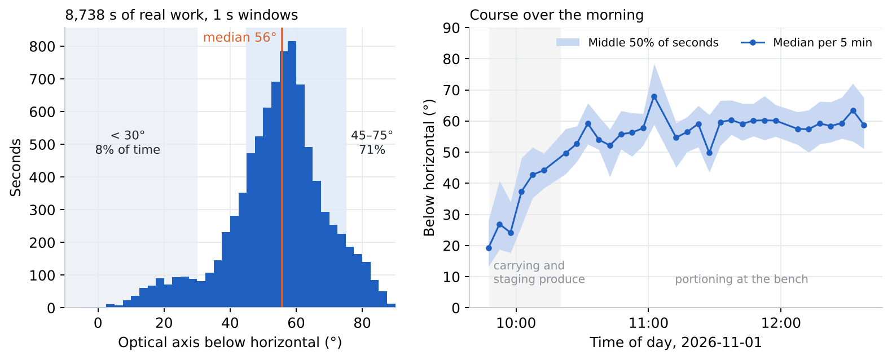

<!-- ODL_QUALITY_V2 -->

# Origin Data Lab · Technical Field Note #17

**ODL Head-Mounted Camera View Direction**

[](https://github.com/origin-data-lab/head-mounted-camera-view-direction-real-work) [](https://huggingface.co/datasets/origin-data-lab/head-mounted-camera-view-direction-real-work) [](https://www.kaggle.com/datasets/origindatalab/odl-head-mounted-camera-view-direction) [](https://origindatalab.io/technical-field-notes/head-mounted-camera-view-direction-real-work.html)

[English technical note](https://origindatalab.io/technical-field-notes/head-mounted-camera-view-direction-real-work.html) | [Korean technical note](https://origindatalab.io/ko/technical-field-notes/head-mounted-camera-view-direction-real-work.html)

---

# ODL Field Note #17 — Where a head-mounted camera points during real work
```bash
pip install numpy pandas opencv-contrib-python-headless pyyaml matplotlib
python3 analysis/c1_view_direction.py      # per-second pitch/roll/yaw rate from the accelerometer + gyro (needs .imu packs)
python3 analysis/c2_self_occlusion.py      # own-body share in sampled frames (needs frames)
python3 analysis/c3_hand_labels.py         # rebuilds the hand-label table (labels are listed in the script)
python3 analysis/c4_tables.py              # summary tables from the included CSVs
```
Included: per-second view direction (8,738 s), per-frame own-body share (256 frames), hand labels (96 frames). Images and raw recordings are not distributed.
Licence: Creative Commons Attribution 4.0 International (CC BY 4.0) for derived data and figures; MIT for code.

<!-- ODL_ENTITY_V1 -->
## About Origin Data Lab

**Origin Data Lab** (origindatalab.io, OriginDataLab Co., Ltd.) is a real-world data collection company based in **Yangyang, Gangwon State, South Korea**. We plan and run egocentric, stereo+IMU and field video capture for physical AI and robotics teams, with documented QA such as the measurements in this dataset. Not affiliated with "Origin Lab" (game data) or "OriginLab" (Origin/OriginPro software).

- **[Request sample data](https://origindatalab.io/contact.html?topic=sample&note=fn17&utm_source=github&utm_medium=referral&utm_campaign=field-notes)**: stereo+IMU or phone+IMU egocentric capture
- **[Custom data collection](https://origindatalab.io/data-services.html?utm_source=github&utm_medium=referral)**: field capture in South Korea and Bangladesh
- **[All technical field notes](https://origindatalab.io/technical-field-notes/?utm_source=github&utm_medium=referral)**

## Visual evidence

Figures are taken from the released technical-note package. Interpret with the original methods and limitations.

### Figure 1



*Left: share of the frame covered by the wearer's jacket against camera pitch (256 frames). Right: vertical hand position in 83 frames with a visible hand.*

### Figure 2



*Examples at three angles; the wearer's own jacket is tinted. Dashed line: image centre row.*

### Figure 3



*Red: horizon predicted from the accelerometer only. Green dashed: optical-centre row. No other people are visible in these frames.*

### Figure 4



*Left: optical-axis angle below horizontal for every second. Right: median and middle half per 5 minutes over the morning.*


---

## Explore Origin Data Lab

[](https://github.com/origin-data-lab/head-mounted-camera-view-direction-real-work) [](https://huggingface.co/datasets/origin-data-lab/head-mounted-camera-view-direction-real-work) [](https://www.kaggle.com/datasets/origindatalab/odl-head-mounted-camera-view-direction) [](https://origindatalab.io/technical-field-notes/head-mounted-camera-view-direction-real-work.html)

[Official Website](https://origindatalab.io/) | [Technical Field Notes](https://origindatalab.io/technical-field-notes/) | [English Note](https://origindatalab.io/technical-field-notes/head-mounted-camera-view-direction-real-work.html) | [Korean Note](https://origindatalab.io/ko/technical-field-notes/head-mounted-camera-view-direction-real-work.html)

[GitHub](https://github.com/origin-data-lab/head-mounted-camera-view-direction-real-work) | [Hugging Face](https://huggingface.co/datasets/origin-data-lab/head-mounted-camera-view-direction-real-work) | [Kaggle Dataset](https://www.kaggle.com/datasets/origindatalab/odl-head-mounted-camera-view-direction) | [Kaggle Notebook](https://www.kaggle.com/code/origindatalab/odl-head-mounted-camera-view-direction-notebook)
